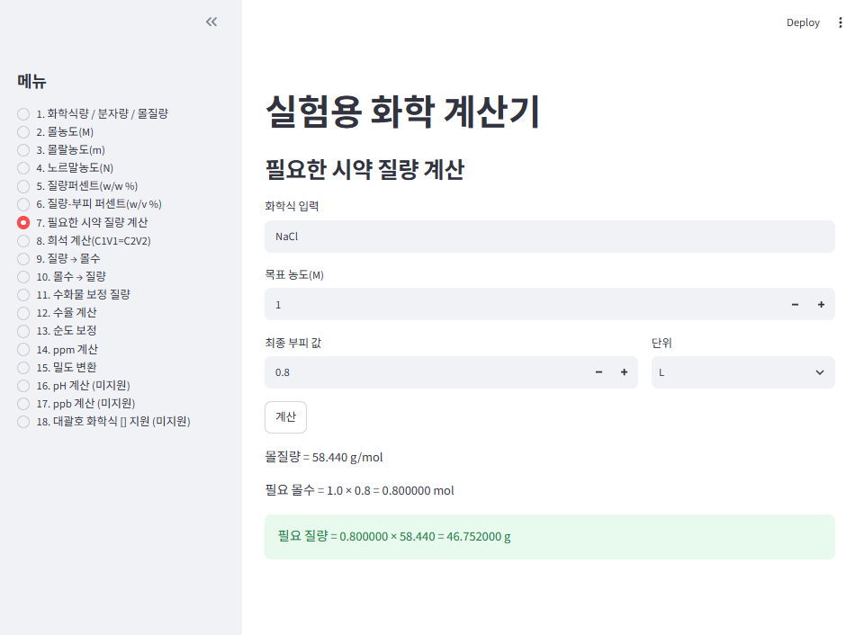
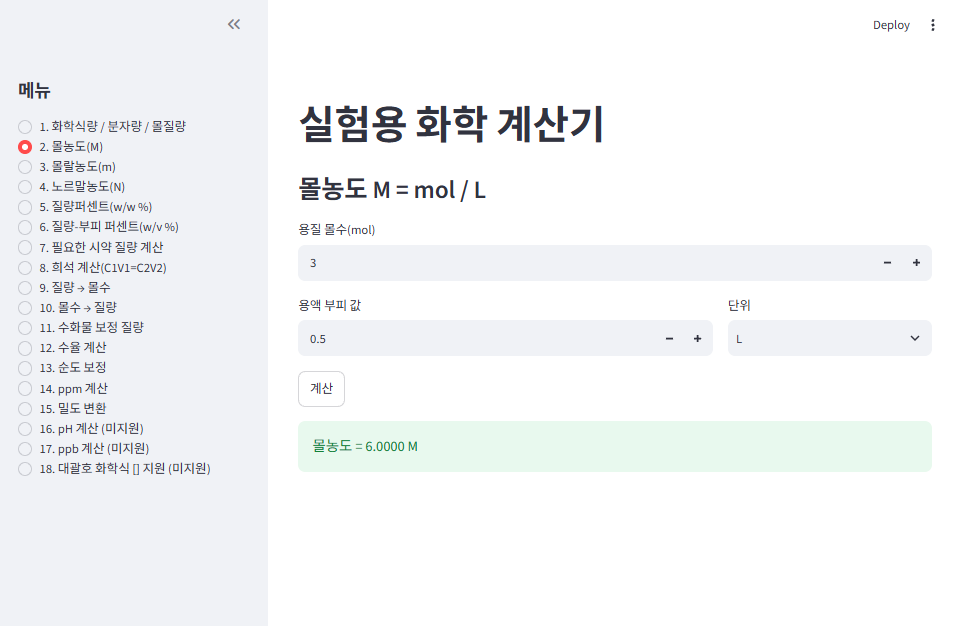

# Chemical Lab Calculator
화학실험 준비 계산 자동화 도구

화학 실험 및 품질관리(QC) 업무에서 반복 사용하는 계산을 자동화한 파이썬 기반 계산기입니다.
Streamlit으로 웹 화면을 연결해 브라우저에서 바로 입력하고 계산할 수 있습니다.
Chemical lab calculator for solution preparation, dilution, and QC-related calculations
---


## 프로젝트 소개

실험 중에는 몰농도, 희석, 수화물 보정, ppm, 순도 보정 등 반복적인 계산이 자주 필요합니다.  
이 과정에서 계산 실수가 발생할 수 있어 이를 줄이고 실험 준비 효율을 높이기 위해 본 프로젝트를 개발했습니다.

화학 전공 지식과 파이썬 학습 내용을 결합하여,  
실제 실험실 및 품질(QC) 직무에서 활용 가능한 실무형 도구를 목표로 구현했습니다.

---
## 웹 화면 (Streamlit)
- 왼쪽 사이드바에서 계산 종류(1~18번)를 선택
- 값과 단위(mg/g/kg, mL/L)를 입력칸에서 바로 선택
- `계산` 버튼을 누르면 계산 과정과 결과가 화면에 표시
- 입력 오류(빈 화학식, 괄호 불일치, 0 이하 값 등)는 오류 메시지로 안내
- 
## 주요 기능

### 1. 화학식 계산
- 화학식량 / 분자량 / 몰질량 계산
- 괄호 화학식 처리
- 수화물 처리
- 계산 과정 출력

### 2. 농도 계산
- 몰농도 (M)
- 몰랄농도 (m)
- 노르말농도 (N)
- 질량퍼센트 (w/w %)
- 질량-부피퍼센트 (w/v %)
- ppm 계산

### 3. 실험 준비 계산
- 필요한 시약 질량 계산
- 희석 계산 (C1V1 = C2V2)
- 질량 → 몰수 변환
- 몰수 → 질량 변환
- 수화물 보정 질량 계산
- 순도 보정
- 밀도 기반 변환

### 4. 결과 계산
- 수율 계산

---

## 예시 기능

### 1. 몰질량 계산
- 입력: `CuSO4·5H2O`  
- 출력: 약 `249.677 g/mol`

### 2. 희석 계산
- 입력: C1 = 1 M, C2 = 0.1 M, V2 = 100 mL  
- 출력: 필요한 원액 부피 `10 mL`

### 3. 순도 보정
- 입력: 10 g, 순도 95%  
- 출력: 약 `10.526 g`

---

## 프로젝트 특징
- 화학 실험 흐름을 반영한 기능 구성
- 단위 변환 기능 포함 (mg/g/kg, mL/L)
- 계산 과정 출력으로 검증 가능
- 미지원 기능은 안내 메시지로 처리
- 기능별 함수 분리로 유지보수 및 확장 용이
- 계산 로직(`chemistry_core.py`)과 화면(`app.py`)을 분리해 화면만 바꿔도 계산식 재사용 가능
- 콘솔 입력 대신 웹 입력창과 단위 선택 상자로 입력 실수 감소
---

## 실행 방법

```bash
pip install -r requirements.txt
streamlit run app.py
```

실행하면 브라우저에서 `http://localhost:8501` 이 열립니다.

---

## 파일 구성

| 파일 | 설명 |
|---|---|
| `app.py` | Streamlit 웹 화면 (메뉴 구성, 입력/출력) |
| `chemistry_core.py` | 화학식 파서, 원자량표, 단위 변환 함수 |
| `requirements.txt` | 필요한 라이브러리 (streamlit) |

---

## 사용 기술
- Python
- Streamlit

---

## 제한 사항 및 향후 계획
- 원자량표에 등록된 22개 원소만 지원합니다.
  (H, C, N, O, Na, Mg, Al, Si, P, S, Cl, K, Ca, Fe, Cu, Ba, Co, Ni, Zn, Mn, Ag, I)
- 대괄호 `[]` 화학식은 아직 지원하지 않습니다.
- pH 계산, ppb 계산은 추후 업데이트 예정입니다.
